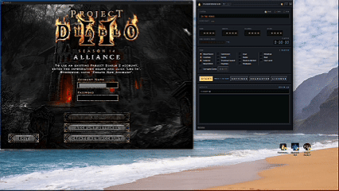

# Pandemonium

### Set it up once. It farms PD2 Bosses for you.

**Gameplay automation for Project Diablo 2: bosses, Cows, Baal, corrupted zones and town upkeep in one app.**

[**⬇️ Download**](../../releases/latest) · [**✨ Features**](#-features) · [**🚀 Quick Start**](#-quick-start) · [**❓ FAQ**](#-faq)

## ✨ Features

### ⚔️ 15 Farming Runs Ready to Go

Turn on the runs you want and Pandemonium does them in order, one game after another.

| Act | Runs |
|:---:|---|
| **I** | 🩸 Blood Raven · 🏰 Countess · 🕷️ Andariel · 🐄 **Secret Cow Level** |
| **II** | 🧪 Blood Witch · 🧙 Summoner · 🪲 Duriel |
| **III** | 🗿 Travincal Council · 💀 Mephisto |
| **IV** | 😈 Izual · 🔥 **Diablo** |
| **V** | 👹 Shenk & Eldritch · 🧟 Pindleskin · 🧿 Nihlathak · 👑 **Baal** |

**Plus:**
- 🌀 **Corrupted zones.** Picks out and clears this season's corrupted areas.
- 🧹 **Level sweeps.** Clears a whole level, not just one boss.
- 🔮 **Shrines picked up on the way.**

### 🗡️ Combat Built Around Your Character

- 🎯 **Separate skill lists** for regular, elite and boss monsters, cast in your order.
- ⏱️ **Faster Cast Rate timing.** Casts as fast as your gear allows without dropped casts.
- 🧠 **Picks its fights.** Walks past lone weak monsters and clears packs with a unique in them.
- 📏 **Range per skill.** Melee stays close; ranged builds keep their distance.
- 🔁 **Weapon swap for buffs.** Casts buffs on your swap weapons, then swaps back.
- 🌊 **Channelled and cooldown skills** like Nova and Blizzard are supported.
- 🛡️ **Buffs kept up** for the whole run.
- 🚫 **No getting stuck on targets it can't hit.** If a monster takes no damage, the bot moves on. The run's main target is never skipped.

### ❤️ Survival

- 🧪 **Drinks potions** based on your health and mana thresholds.
- ☠️ **Death recovery.** Gets your body back and keeps farming.
- 🛑 **Panic key.** Press **`=`** to stop at once, even when the window isn't focused.
- 🐔 **Chicken** Leave the game automatically based on life threshold.

### 💎 Loot Using Your Filter

- 👁️ **Uses the loot filter you already play with.** No separate pickup list to write.
- 🎯 **Accurate pickup clicks**, even with a pile of items on the floor.

### 🏘️ Town Routine

- 💰 **Deposit Materials** in one click: gold, runes, gems, essences, keys and more.
- 📦 **Stashes items across every page**, Personal through Shared IX, and checks each transfer.
- 🏪 **Vendor runs.** Sells unwanted items, repairs gear and refills potions and your belt.
- 🧊 **Horadric Cube** support, using PD2's 4×4 cube.
- 🪙 **Spends extra gold** on the map orb of your choice from Anya when gold builds up.

### 🎛️ Control Panel

- 🖥️ **Docks next to the game** automatically.
- 📊 **Live counters.** Runs, time and status at a glance.
- 📜 **Activity feed** showing what the bot is doing right now.
- ✅ **Setup check before each run.** If something is wrong, it tells you what to fix before you press Start.
- 🧩 **Point-and-click setup.** Settings, characters and zones all have their own windows; no file editing.
- 🗂️ **System tray** controls to start, stop, hide and show.

---

## 🚀 Quick Start

1. **Download** `Pandemonium.zip` from [Releases](../../releases/latest) and extract it.
2. **Set up the game:**
   - Windowed, **1200×900**
   - **Always Show Items** turned **off**
3. **Run** `Pandemonium.exe` and allow Administrator access.
4. Click **Character** to set your skills, and **Settings** to pick your runs.
5. Press **▶ Start** and let it farm.

> 💡 The setup check catches anything you missed, so Start won't let you begin a run that would fail.

---

## 🖥️ Requirements

| | |
|---|---|
| **OS** | Windows 10 / 11 |
| **Game** | Project Diablo 2 |
| **Display** | Windowed, 1200×900 |
| **Permissions** | Administrator |
| **Install** | None. Single `.exe` |

---

## ❓ FAQ

<b>Do I need to write a pickit?</b>

No. Pandemonium picks up what your in-game loot filter shows.

<b>Why 1200×900 and Windowed?</b>

Every on-screen position was measured at that size and renderer. Using the same setup is what keeps the clicks accurate.

<b>What happens if I die?</b>

It goes back for your body, gets your gear and continues with the run list.

<b>How do I stop it right away?</b>

Press **`=`** at any time. Any held keys or mouse buttons are released.

---

Read <a href="DISCLAIMER.md">DISCLAIMER.md</a> before use. Not affiliated with Blizzard Entertainment or Project Diablo II.

